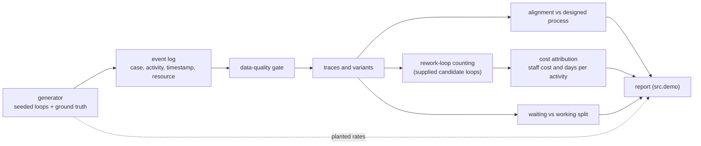

# claimsflow

Conformance checking on synthetic motor-claims event logs that counts known rework loops and costs each one in days and money.

[](https://github.com/saideekshithareddypalpunoori-cloud/claimsflow/actions/workflows/ci.yml)

## Why

An insurer's documented claims process has eleven steps. The real process, reconstructed from event logs, runs dozens of variants, and a large share of claims loop back through earlier steps. Average cycle time hides this completely: a claim that loops twice and a claim with one slow step look identical in the mean.

claimsflow aligns every case against the designed process and, for a supplied set of candidate rework loops, counts how often each fires and attaches an added cycle time and a cost to it, so the output is a ranked list rather than a picture. Loop detection counts occurrences of known candidate patterns (the seeded ones); it does not mine loops from the log.

## Features

- Synthetic event-log generator with **seeded rework loops of known frequency and cost**, so every finding can be checked against ground truth.
- Data-quality gate (monotonic timestamps, known activities, complete cases, no duplicates) that runs before any analysis.
- Variant extraction and alignment-based conformance against the designed process, with a per-case fitness score.
- Rework-loop counting for known candidate patterns, with frequency, added days, cost per occurrence and annualised cost, ranked by cost. Candidate loops are supplied, not discovered.
- Waiting-time versus working-time split, because the two need different fixes.
- Pure Python standard library: nothing to install.

## Architecture



`src/generator.py` produces the log and the planted ground truth. `src/conformance.py` holds the quality checks, alignment, loop detection, costing and time split. `src/demo.py` runs the whole pipeline and prints the report, including how closely the measured loop rates match the planted ones.

## Quick start

Requires Python 3.11 or newer. There are no dependencies.

```bash
git clone https://github.com/saideekshithareddypalpunoori-cloud/claimsflow.git
cd claimsflow
python -m unittest discover -s tests -v   # 20 tests
python -m src.demo                        # full report on 50,000 synthetic claims
```

## Example output

`python -m src.demo` (trimmed):

```text
  50,000 claims, 610,616 events, one quarter of history.
  Data quality gate: PASS (0 issues)

  The designed process has 11 steps.
  The real process has 40 distinct variants.
  Only 32,593 of 50,000 claims (65%) follow the designed path.

  Mean alignment fitness: 0.920

    L3    22% of claims   +4.4 days   GBP    61 each   GBP  3,388,184/yr
        request_estimate -> receive_estimate -> assess
    L2     6% of claims   +2.0 days   GBP    63 each   GBP    835,884/yr
    L1    11% of claims   +2.7 days   GBP    13 each   GBP    320,424/yr

    total annual rework cost: GBP 4,544,492

  WAITING vs WORKING
    working time:      222,307 days
    waiting time:      332,063 days (60% of elapsed)

  Recovery against planted ground truth:
    L3: measured 0.219  planted 0.219  delta 0.0000
```

The log covers one quarter, so costs are annualised by a factor of 4. All cost inputs (`ACTIVITY_COST`, `ACTIVITY_DAYS`) are explicit tables in `src/generator.py`; change them and the report follows.

## How it works

- **Seeded loops.** Three loops are planted at fixed rates: L3 (re-estimate and re-assess, 22%), L1 (re-request photos, 11%) and L2 (re-assess and re-approve after referral, 6%). A loop can fire up to three times in a case, which makes "cases affected" and "occurrences" different numbers. The generator records both, and cost follows occurrences.
- **Alignment.** Each trace is aligned greedily against the designed sequence, giving inserted and missing activities and a fitness of `1 - (inserted + missing) / (trace length + missing)`. This is exact for the repeat-insertion deviations the generator produces. It is not the optimal A* alignment used by full conformance checkers.
- **Loop counting.** The candidate loops are the seeded patterns from `src/generator.py`, which drive both the generator and the detector. For each pattern, an occurrence counts as rework only when the same sub-sequence already appeared earlier in the trace. Nothing is mined from the log, so the recovery check below is partly circular: the detector is given the patterns, and only the counts are independently measured.
- **Costing.** Cost per occurrence is the sum of per-activity staff cost; added days is the sum of per-activity durations. Annual cost is occurrences times cost times the annualisation factor.
- **Waiting versus working.** `receive_photos` and `receive_estimate` are classed as waiting on third parties; everything else is working time.
- **Quality gate first.** Out-of-order timestamps invent loops, truncated cases hide real ones, and duplicates inflate frequencies, so the checks run before any analysis.

## Testing

```bash
python -m unittest discover -s tests -v
```

The suite asserts that each seeded loop's frequency is recovered within one percentage point and its cost within 5%, that the costliest loop ranks first, that alignment reports inserted and missing steps correctly, that each quality check fires on a deliberately corrupted log, and that the cost model is consistent with its inputs. CI runs the same command on Python 3.12.

## Project layout

```text
src/
  generator.py     designed process, cost tables, seeded loops, log generator
  conformance.py   quality gate, variants, alignment, loop detection, costing, time split
  demo.py          end-to-end report
tests/
  test_conformance.py
docs/
  ARCHITECTURE.md
```

## Limitations

- No loop discovery: candidate loops are supplied, and the detector only counts them.
- The data is synthetic. There is no importer for real event logs (XES or CSV) yet.
- Alignment is greedy, not optimal; it would under-explain deviations such as swapped or skipped-and-repeated steps.
- Costs are flat per-activity staff costs; indemnity leakage is not modelled.
- The designed process is a single linear sequence, not a full BPMN model.

## License

MIT, see [LICENSE](LICENSE).

## Maintainer

Maintained by **SAI DEEKSHITHA REDDY PALPUNOORI**, a Supply Chain Analyst with experience in operational analytics and process improvement.

- GitHub: [saideekshithareddypalpunoori-cloud](https://github.com/saideekshithareddypalpunoori-cloud)
- LinkedIn: [Sai Deekshitha Reddy Palpunoori](https://www.linkedin.com/in/sai-deekshitha-reddy-palpunoori-b38b60215/)
- Email: [saideekshithareddypalpunoori@gmail.com](mailto:saideekshithareddypalpunoori@gmail.com)