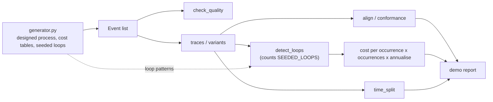

# Architecture

## Context

Insurers document a claims process but run something messier. Event logs record what actually happened, and the question is which deviations cost money. claimsflow answers that for one process: motor claims, from registration to closure.

## Components

Everything is plain Python dataclasses and the standard library. An `Event` is `(case_id, activity, timestamp, resource)`, with timestamps in working days since case start.

## Key decisions

- **Generate the data first, with planted truth.** A process map looks convincing for any log. Seeding loops at known rates and costs lets the analysis be scored: tests require frequency within 1 point and cost within 5%.
- **Conformance against the designed process, not the discovered one.** Discovery describes what happens; only a reference model says which behaviour is a deviation. The reference here is `DESIGNED_PROCESS`.
- **Seeded patterns drive both sides.** The same `SEEDED_LOOPS` definitions are used by the generator to plant loops and by `detect_loops` to count them. `detect_loops` does not discover loops from traces; it counts occurrences of supplied candidates, so recovery of planted rates checks the counting and costing, not discovery.
- **Cost every loop.** Each loop gets days and money from explicit per-activity tables, so a stakeholder can challenge an input instead of a black-box figure.
- **Separate waiting from working time.** Waiting on photos or estimates is not fixed by more staff, so the split changes which intervention makes sense.
- **Greedy alignment.** It is exact for repeat-insertion deviations, which is all the generator produces, and far simpler than A*. The trade-off is that it can overstate deviations for other shapes of deviation.

## Failure modes

- Dirty logs: `check_quality` flags non-monotonic timestamps, unknown activities, cases that start mid-process, and duplicate case/activity/timestamp rows. The report prints the gate result before any findings.
- Cases and occurrences diverge when a loop fires more than once; the report uses cases for rate and occurrences for cost.

## Out of scope

- Loop discovery (candidate loops are supplied), importing real event logs, BPMN parsing, optimal alignments, and indemnity-leakage costing.
